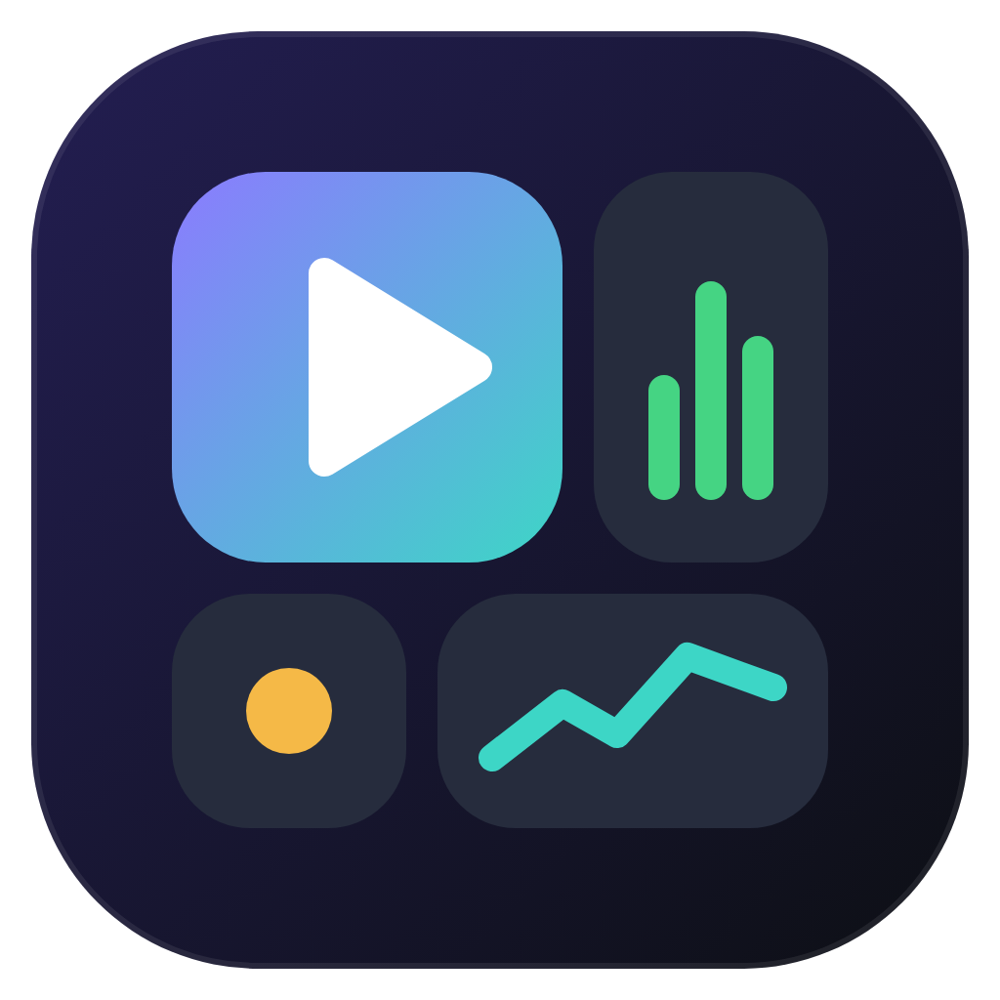

<p align="center"></p>

<h1 align="center">OminiGameDesk</h1>

<p align="center">
  <b>All your everyday and gaming widgets in one window, plus study quizzes and duels.</b><br>
  A free widget dashboard for Windows, macOS and Linux.
</p>

> **OminiGameDesk was called GameDesk until version 1.8.** Installing OminiGameDesk 2.0 on Windows moves your widgets, notes, links, AI settings and quizzes over and removes the old GameDesk. On a Mac, delete the old GameDesk from Applications yourself; your data comes along.

<p align="center">
  <a href="https://github.com/CillX1/OminiGameDesk/releases/latest"></a>
  <a href="https://github.com/CillX1/OminiGameDesk/releases"></a>
  
  <a href="LICENSE"></a>
</p>

<h3 align="center"><a href="https://github.com/CillX1/OminiGameDesk/releases/latest">⬇ Download OminiGameDesk</a> for Windows, Mac or Linux</h3>

## Features

| | |
|---|---|
| 🎵 **Spotify** | Play, pause and skip with album art. Press play and Spotify starts hidden in the background. |
| 🤖 **AI chat** | A free AI that runs on your own PC (Ollama), or Claude with your own API key. |
| 📊 **PC stats** | CPU, RAM, disk, battery and ping at a glance. |
| 🛡️ **Anti-Freeze** | Spots programs that stop responding and lets you end them with one click, or automatically. Warns you before memory runs out. |
| 🎮 **Games** | Launch Steam, Xbox, Ubisoft, Epic, EA, Battle.net and more, plus your installed Steam games. |
| 🛠️ **Quick tools** | System shortcuts, weather, to-do list, timer and notes. |
| 🧠 **Quizzes** | [QuizDesk](https://github.com/CillX1/QuizDesk) built in: study quizzes that work offline, the shared quiz collection to download from, and duels (live with a room code, or challenge codes). Works together with the standalone QuizDesk app. |
| 🔗 **Quick links** | Your favourite websites one click away. Add or remove them with **Edit links**. |
| 🎨 **Customize** | Hide the widgets you don't need. |

## Install

All downloads are on the [latest release](https://github.com/CillX1/OminiGameDesk/releases/latest) page.

### 🪟 Windows 10 / 11

1. Download `OminiGameDesk-Setup-<version>.exe` and run it. It installs for your user only, so no admin rights are needed.
   The installer isn't code-signed, so Windows may say *"Windows protected your PC"*: click **More info**, then **Run anyway**.
2. OminiGameDesk starts. Next time, open it from the Start menu or the desktop shortcut.

Needs Microsoft Edge, which Windows has by default. **Without the installer:** download the `windows-portable.zip`, extract it and double-click `Install OminiGameDesk.bat`.
**Uninstall:** Settings > Apps > Installed apps > OminiGameDesk > Uninstall.

### 🍎 macOS

1. Download the `.dmg`: `arm64` for Apple Silicon (M1 and newer), `x64` for older Intel Macs.
2. Open it and drag **OminiGameDesk** into **Applications**.
3. The app isn't notarized by Apple, so the first time macOS blocks it. Open **System Settings > Privacy & Security**, scroll down and click **Open Anyway** next to OminiGameDesk. After that it opens normally.

The first time you use the Spotify buttons, macOS asks whether OminiGameDesk may control Spotify: click **OK**.
**Uninstall:** drag OminiGameDesk from Applications to the Trash.

### 🐧 Linux

- **Ubuntu, Debian, Mint, Pop!_OS:** download the `.deb` and open it, or run `sudo apt install ./OminiGameDesk-<version>-amd64.deb`.
- **Any other distro:** download the `.AppImage`, make it executable (`chmod +x OminiGameDesk-*.AppImage`) and run it. Some distros need `libfuse2` for AppImages.

Spotify controls use the standard MPRIS interface (`gdbus`, included in most desktops). Volume buttons use PipeWire (`wpctl`), PulseAudio (`pactl`) or ALSA (`amixer`).

### What works where

| | Windows | macOS | Linux |
|---|:-:|:-:|:-:|
| Spotify controls, song and album art | ✅ | ✅ | ✅ |
| Start Spotify hidden in the background | ✅ | ✅ | starts normally |
| CPU, RAM, disk, battery, ping | ✅ | ✅ | ✅ |
| Anti-Freeze: end frozen programs (also automatically) | ✅ | – | – |
| Anti-Freeze: warning when memory is almost full | ✅ | ✅ | ✅ |
| Steam games and game launchers | ✅ | ✅ | ✅ (Steam, Heroic, Lutris, ...) |
| AI chat (local and Claude) | ✅ | ✅ | ✅ |
| Quick tools | Windows tools | Mac apps and settings | GNOME, KDE or Xfce apps |
| Xbox Game Bar, Game Mode | ✅ | – | – |

## Anti-Freeze

While OminiGameDesk is open (minimized is fine), it checks every 3 seconds for programs that show "Not Responding" and for memory that is almost full, and shows a notification. In the Anti-Freeze widget you can end a frozen program with **End**, or tick **End frozen programs automatically** to let OminiGameDesk do it after 15 to 120 seconds. Windows itself (Explorer, the taskbar and system processes) is never ended.

It can't help when the whole computer freezes because of a driver or hardware problem: then OminiGameDesk freezes too.

## AI chat

- **Free local AI:** install [Ollama](https://ollama.com/download), then in OminiGameDesk's AI panel pick *Local AI* and click *Download (3.3 GB)*. It runs on your own computer and works offline; 16 GB of RAM or more is recommended.
- **Claude (optional):** pick *Claude* and paste an API key from [console.anthropic.com](https://console.anthropic.com) (Settings > API keys). API use is billed separately from a Claude Pro plan. The key is stored encrypted on your computer only.

## Privacy

OminiGameDesk runs a small server on your own computer (`127.0.0.1` only) that the dashboard window talks to. It doesn't send your data anywhere. Weather comes from open-meteo.com, Steam game pictures from Steam and album covers from Spotify. Claude chat messages go to Anthropic's API only when you send them.

## How it's built

All three versions share one dashboard page, `OminiGameDesk/dashboard.html`. Behind it:

- **Windows:** plain PowerShell (`OminiGameDesk/OminiGameDesk.ps1`) that opens the page in an Edge app window. Nothing to compile. Run it straight from the repo with `powershell -NoProfile -ExecutionPolicy Bypass -File OminiGameDesk\OminiGameDesk.ps1`. The installer is built with [Inno Setup 6](https://jrsoftware.org/isinfo.php) from `installer/OminiGameDesk.iss`.
- **macOS and Linux:** a small [Electron](https://www.electronjs.org) app in `desktop/` with the same local API. Run it with `cd desktop && npm install && npm start`; build installers with `npm run dist:mac` or `npm run dist:linux`.

### Releasing

Bump `$version` in `OminiGameDesk/Install.ps1` and `version` in `desktop/package.json`, then push a tag:

```bash
git tag v1.6.0
git push origin v1.6.0
```

GitHub Actions ([`.github/workflows/release.yml`](.github/workflows/release.yml)) builds the Windows installer, the Mac `.dmg` files and the Linux `.AppImage` and `.deb`, and attaches them all to a new GitHub release. Every push to `main` also builds them as a test, downloadable from the run's page.

## License

OminiGameDesk is free software under the [GNU GPL v3](LICENSE).
